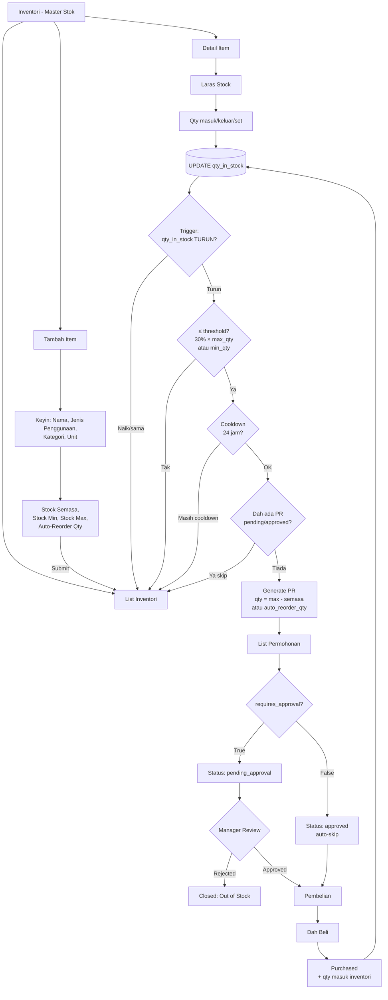
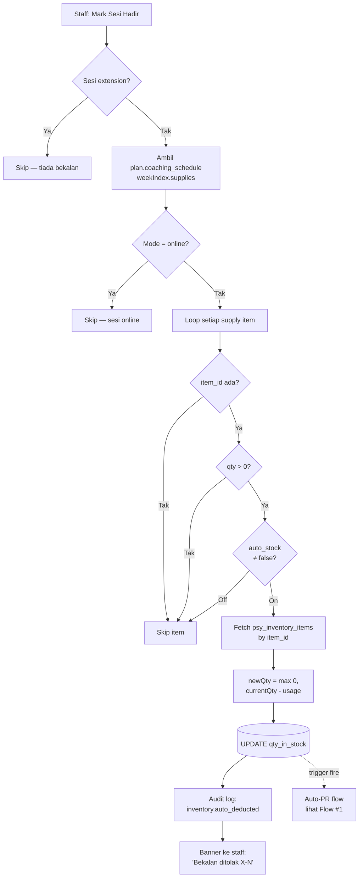
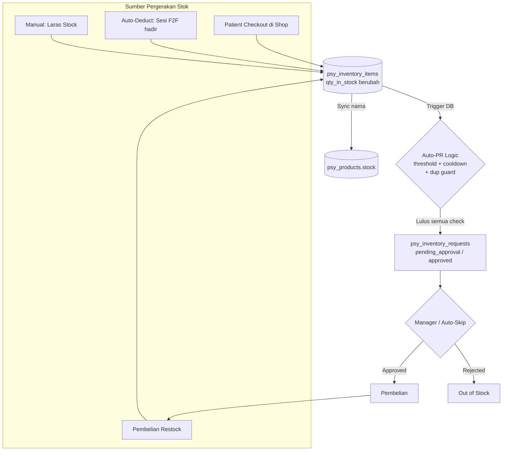

# Flow Inventori — ISW System

Dokumentasi lengkap flow inventori, merangkumi auto-PR, auto-deduct bekalan sesi, sync produk shop, dan helicopter view ekosistem.

Sumber kod rujukan:
- [database/step_inventory_auto_trigger.sql](../database/step_inventory_auto_trigger.sql)
- [shared/inventoryDeduct.js](../shared/inventoryDeduct.js)
- [shared/stockSync.js](../shared/stockSync.js)
- [roles/staff/inventory.html](../roles/staff/inventory.html)
- [roles/staff/inventory-detail.html](../roles/staff/inventory-detail.html)

---

## 1. Flow Utama Inventori (Auto-PR)

Trigger PR berlaku **hanya bila `qty_in_stock` TURUN** dan lulus 3 check: threshold, cooldown 24 jam, duplicate guard.



**Nota penting:**
- `threshold = 30% × max_qty` jika `max_qty` diset, jika tidak fallback `min_qty`.
- `reorder_qty = auto_reorder_qty` jika ada, jika tidak `max_qty - qty_in_stock`.
- Cooldown 24 jam disimpan dalam `last_auto_po_at`.
- Duplicate guard: skip jika ada PR `pending_approval` atau `approved` untuk item sama.

---

## 2. Flow Auto-Deduct Bekalan Sesi F2F

Bila staff mark sesi 'hadir', sistem auto-deduct bekalan dari `coaching_schedule[weekIndex].supplies`.



---

## 3. Flow Sync Inventori ↔ Produk Shop (dwi-arah)

Stok sync antara `psy_inventory_items` dan `psy_products` melalui match nama (case-insensitive, trim).

```mermaid
flowchart LR
    subgraph STAFF[Staff Side]
        IE[Inventory-Detail<br/>laras stok]
        PE[Product-Edit<br/>update stok]
        PA[Products: Tambah baru]
    end

    subgraph DB[(Database)]
        INV[(psy_inventory_items)]
        PRD[(psy_products)]
    end

    subgraph PATIENT[Patient Side]
        SH[Shop: lihat produk]
        CO[Checkout / Beli]
    end

    IE -->|update qty_in_stock| INV
    INV -.->|syncStockToProducts<br/>match by name| PRD

    PE -->|update stock| PRD
    PRD -.->|syncStockToInventory<br/>match by name| INV

    PA -->|insert produk baru| PRD
    PRD -.->|ensureInventoryCounterpart<br/>auto-create kalau tiada| INV

    PRD --> SH
    SH --> CO
    CO -->|deduct stock<br/>via FK link / nama| PRD
    CO -.->|sync| INV
```

---

## 4. Helicopter View — Ekosistem Penuh

Semua sumber pergerakan stok dan kesannya ke auto-PR.



---

## Ringkasan Rule

| Rule | Nilai | Sumber |
|---|---|---|
| Threshold auto-PR | `30% × max_qty` atau `min_qty` (fallback) | step_inventory_auto_trigger.sql |
| Cooldown | 24 jam (`last_auto_po_at`) | step_inventory_auto_trigger.sql |
| Duplicate guard | Skip jika ada PR `pending_approval`/`approved` untuk item sama | step_inventory_auto_trigger.sql |
| Reorder qty | `auto_reorder_qty` atau `max_qty - qty_in_stock` | step_inventory_auto_trigger.sql |
| Trigger arah | Hanya bila qty TURUN | step_inventory_auto_trigger.sql |
| Auto-deduct skip | extension, online, qty=0, auto_stock=false | inventoryDeduct.js |
| Sync match | Nama case-insensitive + trim | stockSync.js |
